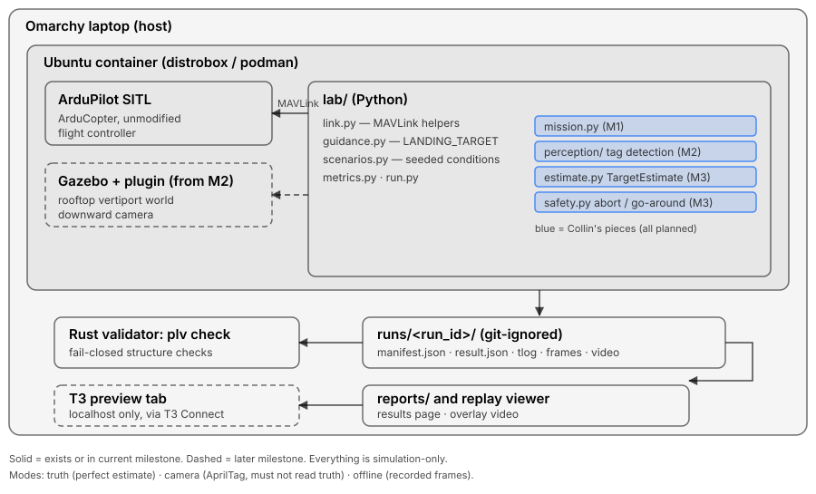

# Precision Landing Lab

An autonomous copter finds a rooftop vertiport pad in simulation and lands on it, or it safely aborts and goes around. The lab is built around Advanced Air Mobility (AAM) and around one idea: show measured results, safe aborts and honest limits.

Procedures in this repository follow ASD-STE100 Simplified Technical English.

## Status (honest)

Early. Milestone M1 (first flight) is in progress.

| Works now | Not yet |
|---|---|
| ArduPilot Copter 4.7.2 SITL builds and flies a scripted GUIDED takeoff to 5 m, hold and LAND (gate P2-a) | The owner's own mission code (`landing-pilot`) |
| Pinned SITL launcher, locked MAVProxy dependencies | Gazebo world with the camera and AprilTag pad |
| MAVLink log exporter (CRC-checked) and a three.js replay viewer | Vision-based landing, abort and go-around logic |
| Learner package: `scripts/learn init`, step tests, hints, mastery gate | Any measured landing accuracy |
| Rust run validator (`plv`) and CI | |

No landing-accuracy numbers are published until they come from pre-registered, held-out seeds (see `docs/plan/landing-lab-plan-v2.md`, section 7).

## Who wrote what

This repository is the **platform**. An AI agent team (Claude and Codex models) builds it, and Collin Craig directs and reviews it. Agent commits use an agent identity, for example `Landing Lab Agent (claude-sonnet-5-5)`. Each task and its review rounds are listed in `docs/evals/agent-team-log.md`.

Note on older history: before 2026-11-11 (decision D-036), agent commits used Collin's name. Commits under his name before that date therefore include agent-written changes. From 2026-11-11 on, agents commit only under an agent identity.

Collin's **own** autonomy code lives in a separate repository, `landing-pilot`: the mission state machine, frame chain, estimator and abort logic. He writes it himself, without AI-written solutions. It becomes public with its first flight.

## Architecture

Details: `docs/architecture.md`, `docs/pilot-interface.md`.

## Try it

Requirements: Linux, distrobox with an Ubuntu container, an ArduPilot Copter 4.7.2 SITL build. Setup: `docs/m1-container-setup.md`.

1. Start SITL: `scripts/sitl-up` (see `docs/sitl-up.md`).
2. Connect MAVProxy: `mavproxy.py --master udpin:127.0.0.1:14550`.
3. Export a flight log and replay it in the viewer: see `docs/export-flight.md`.
4. Create a pilot repository for the learner exercises: `scripts/learn init` (see `docs/pilot-interface.md`).

## Plan and decisions

- Plan and sequence: `docs/plan/landing-lab-plan-v2.md`
- Milestones: `docs/milestones.md`
- Decision log: `docs/decisions.md`
- Upstream problems found by the lab: `docs/upstream-candidates.md`

## License

Apache-2.0. See `LICENSE` and `NOTICE`. Third-party material: `THIRD_PARTY.md`. ArduPilot is not included in this repository.
